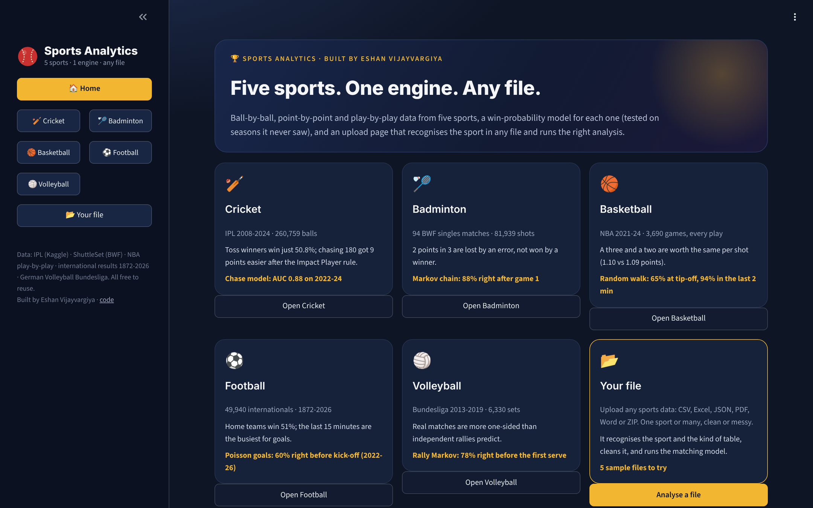
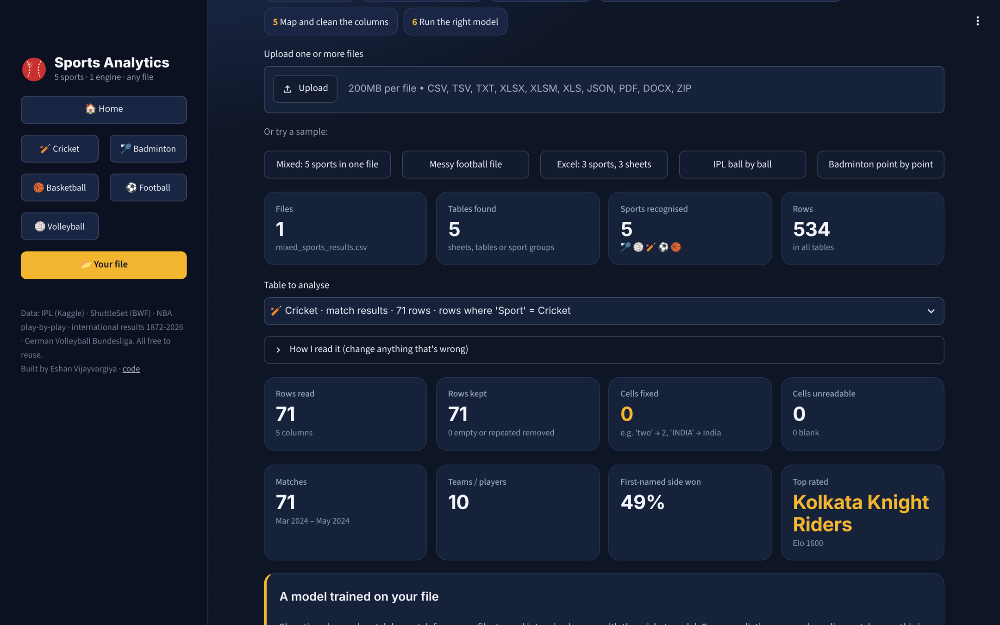
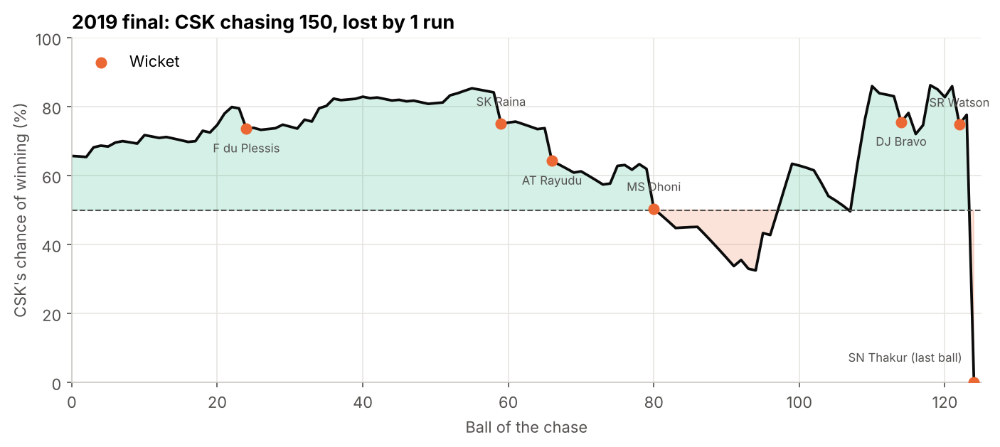
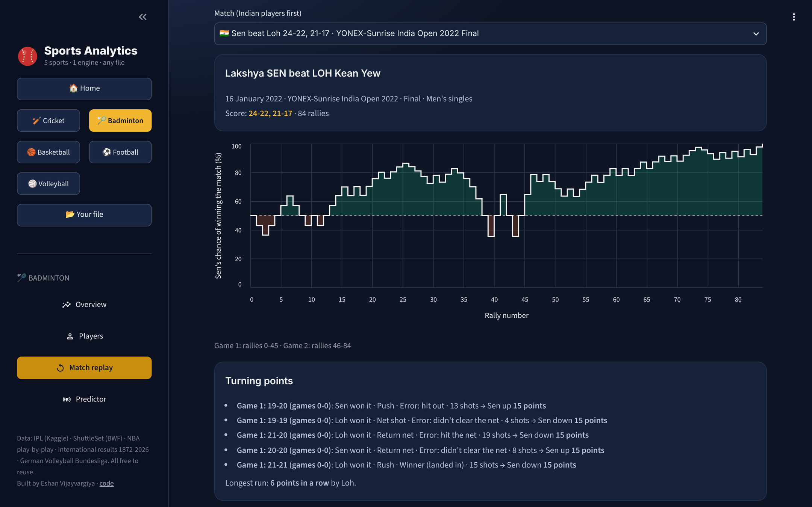
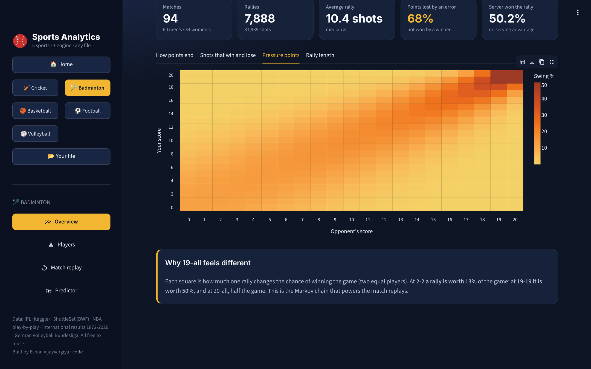
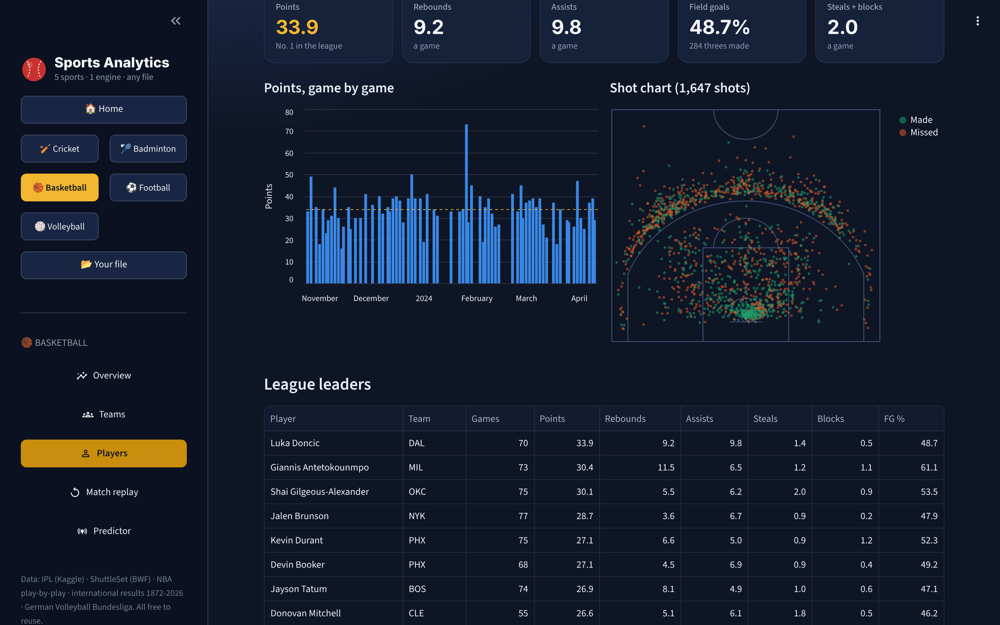
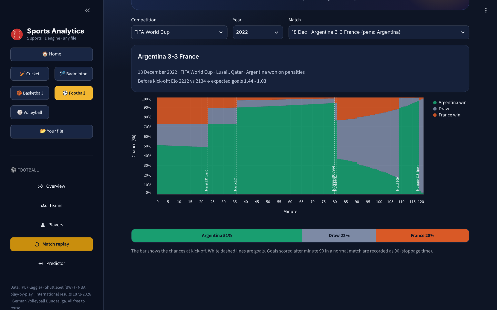
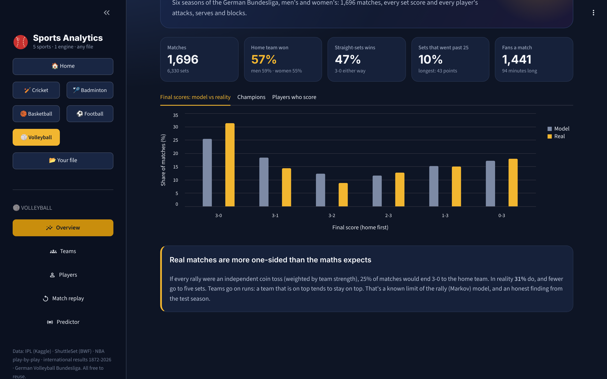

# Sports Analytics: five sports, one engine, any file

**Can one analytics engine understand any sport? This project answers that with cricket, badminton, basketball, football and volleyball: real professional data, a win-probability model for each sport (tested on seasons it never saw), and an upload page that recognises the sport in any file and runs the right analysis.**

It started as an IPL project (2008-2024, ball by ball) and grew into five sports. Each sport is scored differently, so each one gets the maths that fits it:

| Sport | Data | Model | Tested on unseen data |
|---|---|---|---|
| 🏏 **Cricket** | IPL 2008-2024 · 1,095 matches · 260,759 balls | Logistic regression on spline features | 2022-24 chases: **AUC 0.88** (vs 0.84 for required rate alone) |
| 🏸 **Badminton** | 94 top BWF singles matches 2018-22 · 7,888 rallies · 81,939 shots | Markov chain (rally scoring to 21) | 2022 matches: **76%** right rally by rally, **88%** after game 1 |
| 🏀 **Basketball** | NBA 2021-24 · 3,690 games · every play | Random walk (normal model) + Elo | 2023-24: **AUC 0.87**; 65% right at tip-off, **94%** in the last 2 minutes |
| ⚽ **Football** | 49,940 internationals 1872-2026 · minute of every goal | Poisson goals + Elo | 2022-26: **60%** right before kick-off (log loss 0.878 vs 1.051), **88%** by the 85th minute |
| 🏐 **Volleyball** | German Bundesliga 2013-19 · 1,696 matches · 6,330 sets | Rally Markov chain + Elo | 2018/19: **78%** right before the first serve (AUC 0.88), 84% after 2 sets |

### ▶ [Open the live app](https://eshan-sports-analytics.streamlit.app/)

[](https://eshan-sports-analytics.streamlit.app/)
No install needed. Replay the 2022 World Cup final minute by minute, Lakshya Sen's India Open final rally by rally, or Luka Dončić's 73-point game play by play, or **upload your own sports file**. (Free hosting: if the app has been asleep, click "Yes, get this app back up" and give it a minute.)

     



---

## 1. The "any sports file" engine

Upload one file or several (CSV, Excel with any number of sheets, JSON, PDF, Word, or a ZIP of them). The engine, in `app/engine.py`:

1. **Reads every table**: finds the real header even under title rows, guesses the delimiter and encoding, reads every Excel sheet and every PDF/Word table.
2. **Splits mixed files by sport**: if a column says the sport (even spelt "FOOTBALL", "soccer", "Basketbal" or "volley ball"), rows are grouped per sport. Unknown sports (kabaddi, hockey) are set aside, not forced into the wrong model.
3. **Recognises the sport** with a points system and shows its evidence: words in column names (`over`, `bowler` → cricket; `REB`, `AST` → basketball; `FTHG` → football; `libero`, `aces` → volleyball; `rally`, `smash` → badminton), known team and player names, and score patterns (`21-19, 15-21` is badminton, `25-23` volleyball, `180/5` cricket, `112-108` basketball, `2-1` football).
4. **Recognises the kind of table**: match results, play-by-play (ball-by-ball, point-by-point, goal timeline, set scores) or player stats, and maps each column to its role (home team, away score, over, batter...).
5. **Cleans it**: `"two"` → 2, `"45+2"` → 45, `"INDIA"`/`" india "` → India, mixed date formats, `N/A` and blanks, repeated rows, and shows every fixed or unreadable cell highlighted.
6. **Runs the model that fits**: for results it **trains Elo ratings on your file** and tests them walk-forward (each prediction uses only earlier matches); for play-by-play it runs that sport's win-probability replay; for player tables it builds leaderboards with sport-aware rates (strike rate, points a game, attack success %).

Anything it gets wrong can be changed in **"How I read it"** (sport, kind of table, any column).



**Built not to fail in an interview.** I threw **188 generated files** at it: random tables in 8 formats, empty files, binary garbage named `.xlsx`/`.pdf`/`.zip`, web pages saved as `.csv`, 150-column tables, `1e308` and `inf` scores, misspelt sport names, and the real samples with columns shuffled, renamed, dropped and 10% of cells corrupted. Result: **0 crashes**. Unreadable files get a plain-English reason; everything else runs end to end. The same test through the real page (62 files, every table in each) gave 0 errors.

## 2. Cricket: what actually wins IPL matches?

The original project, now the cricket section. The full analysis is in [`notebooks/ipl_analysis.ipynb`](notebooks/ipl_analysis.ipynb).

| Finding | Number |
|---|---|
| Winning the toss barely helps | Toss winners won **50.8%** (binomial test p = 0.61) |
| Choosing to field helps | **53.9%** won after fielding first vs **45.4%** after batting (chi-square p = 0.009) |
| The ground matters more than the toss | Chases succeed **43%** at Chepauk, **65%** in Jaipur |
| The Impact Player rule made scoring explode | Average first innings **171 (2022) → 190 (2024)**; 200+ totals **18 → 41** |
| Economy is about boundaries, not dot balls | Correlation with economy: boundary % **r = 0.84**, dot-ball % **r = -0.11** |

**Cleaning:** 19 team names for 15 franchises, 58 spellings for 36 grounds, super overs stored as extra innings, 21 rain-shortened and 5 abandoned matches.

**Win-probability model** (every legal ball of 1,055 chases; trained on 2008-21, tested on 2022-24, cross-validation grouped by match):

| Model | Test log loss | Test AUC |
|---|---|---|
| Required run rate only | 0.502 | 0.839 |
| Logistic regression | 0.448 | 0.871 |
| Gradient boosting | 0.451 | 0.874 |
| **Logistic regression + splines (final)** | **0.444** | **0.878** |



## 3. Badminton: how top points are won

ShuttleSet data: every shot of 94 BWF World Tour singles matches, hand-labelled from broadcast video, including **Lakshya Sen, PV Sindhu, Srikanth, Prannoy, Sameer Verma and Aakarshi Kashyap**.

- **2 points in 3 are lost, not won**: only 32% of rallies end with a winner; the rest are shots hit out (31%), into the net (34%) or left alone when landing in.
- **Attack wins points**: a smash is an outright winner about 1 time in 7 and a rush at the net almost 1 in 2; net shots and lobs fail far more often than they win.
- **No serving advantage**: the server won 50.2% of rallies.
- **Pressure is real, mathematically**: from 19-all, one rally is worth 50% of the game, almost **4×** a rally at 2-2.

**Model:** a Markov chain gives the exact chance of winning the game and match from any score; during a match, the rally-win estimate learns from the rallies already played. Trained on 2018-21, tested on 50 matches from 2022:

| Model | Log loss (rally by rally) | Accuracy |
|---|---|---|
| Score only, every rally 50/50 | 0.483 | 77% |
| **Score + rallies won so far (final)** | **0.456** | 76% |
| + player ratings from 2018-21 | 0.494 | 74% |

An honest result: **player ratings made it worse**. With only 44 earlier matches (and only 14 of the 50 test matches having both players in them), there isn't enough history to rate players, so the final model uses the score and the match itself. After game 1 it names the winner **88%** of the time.

| Rally-by-rally replay | Pressure points |
|---|---|
|  |  |

## 4. Basketball: what decides an NBA game?

Three seasons of NBA play-by-play: 3,690 games, 435,000 scoring plays and 650,000 shots (the app draws 2023-24 shot charts). Player numbers match the official ones (Dončić 2023-24: 33.9 points, 9.2 rebounds, 9.8 assists).

- **Why everyone shoots threes**: a two goes in 54.5% and a three 36.6%, so each attempt is worth about the same (**1.09 vs 1.10 points**), but the mid-range jumper (10-22 feet) returns only 0.87 points a shot, against 1.33 at the rim.
- **Home court** is worth about 3.5 points; home teams won 55%.
- **Leads**: a 10-point lead at half-time wins about 3 games in 4; with 5 minutes left, 97%.

**Model:** the final margin is treated as a **random walk**: normal around the current margin plus the expected margin for the rest of the game (from Elo and home court), with uncertainty that shrinks with the square root of the time left. I tested that assumption by fitting the exponent instead of fixing it at 0.5: the data said **0.504**.

| Model (trained 2021-23, tested on all 1,230 games of 2023-24) | Log loss | AUC |
|---|---|---|
| Score and clock only | 0.480 | 0.840 |
| **+ Elo team strength and home court (final)** | **0.444** | **0.868** |



## 5. Football: 150 years of internationals

- **Scoring fell** from 5.6 goals a match in the 1880s to about 2.7 since the 1980s.
- **The last 15 minutes are the busiest**: 1 goal in 5 comes after the 75th minute.
- **Home advantage** has hardly moved in 100 years: home teams win 51%, away teams 26%.

**Model:** Elo ratings (World Football Elo rules) for every national team since 1872, and a **Poisson goal model** (scikit-learn `PoissonRegressor`) on the Elo gap, home advantage and match type, which gives win/draw/loss and every scoreline. In play, goals still to come are Poisson, scaled by the share of goals usually scored after that minute.

| Model (trained 1990-2021, tested on 5,068 matches from 2022-26) | Log loss | Accuracy |
|---|---|---|
| Base rates | 1.051 | 48% |
| Elo expected score | 0.894 | 60% |
| **Poisson goal model (final)** | **0.878** | **60%** |

In play (1,918 test matches): 68% right at kick-off, 74% at the hour, **88% at 85 minutes**.



## 6. Volleyball: what wins a match?

- **Home teams win 57%** (men 59%, women 55%); 47% of matches are 3-0 either way.
- **Berlin won 5 of 6 men's titles**; Dresden, Schwerin and Stuttgart shared the women's.

**Model:** Elo gives each team's chance of winning a single rally (a logistic link fitted on every rally of the training seasons); a **Markov chain** with volleyball rules (sets to 25, a fifth set to 15) turns that into the chance of winning the match and of each final score.

| Model (trained 2013-18, tested on 307 matches of 2018/19) | Log loss | Accuracy | AUC |
|---|---|---|---|
| Home team always wins | 0.691 | 54% | 0.50 |
| Elo expected score | 0.452 | 79% | 0.88 |
| **Rally Markov chain (final)** | **0.434** | **78%** | **0.88** |

**A limit I found:** the chain expects 25% of matches to end 3-0 to the home team, but 31% really do. Rallies aren't independent: teams go on runs.



## Project structure

```
├── app/
│   ├── app.py                 # router: home, 5 sports, upload page
│   ├── engine.py              # any file → tables → sport → kind of table → column roles → cleaning
│   ├── analyse.py             # analysis + models for uploaded tables
│   ├── rally.py               # Markov chain for rally-point sports (badminton, volleyball)
│   ├── football.py · basketball.py · badminton.py · volleyball.py   # cleaning + models per sport
│   ├── ipl_data.py · stats.py · winprob.py                          # cricket
│   ├── pg_*.py                # one page module per sport, plus home and upload
│   ├── data/                  # cleaned tables (about 10 MB)
│   └── demo/                  # 5 sample files for the upload page (cut from the real data)
├── models/                    # trained models + their test scores (JSON)
├── scripts/                   # get_data.py and build_<sport>.py: raw data → clean tables → trained, tested models
├── notebooks/ipl_analysis.ipynb
└── images/
```

## Run it yourself

```bash
pip install -r requirements.txt
python -m streamlit run app/app.py
```

To rebuild everything from the raw data: `pip install -r requirements-notebook.txt`, then `python scripts/get_data.py`, then the `scripts/build_*.py` files (see [data/README.md](data/README.md)).

## Data and licences

| Sport | Source | Licence |
|---|---|---|
| Cricket | [IPL Complete Dataset 2008-2024](https://www.kaggle.com/datasets/patrickb1912/ipl-complete-dataset-20082020) (Kaggle) | public dataset |
| Badminton | [ShuttleSet / ShuttleSet22](https://github.com/wywyWang/CoachAI-Projects) (Wang et al., KDD 2023) | MIT |
| Basketball | [shufinskiy/nba_data](https://github.com/shufinskiy/nba_data) (NBA play-by-play) | Apache-2.0 |
| Football | [martj42/international_results](https://github.com/martj42/international_results) | CC0 |
| Volleyball | [volleystat](https://github.com/bozhinvi/volleystat) (German Bundesliga) | CC0 |

## Limitations

- **Badminton** is singles only, and 94 matches is a small sample (the data is hand-labelled from video).
- **Volleyball** has set scores, not every rally, so its replay moves set by set.
- **Scores don't know who is playing**: none of the in-play models knows that Dhoni is at the crease or LeBron is on the bench.
- The upload engine is rule-based. It explains its guesses and lets you correct them rather than pretending to be sure.

---

Built by **Eshan Vijayvargiya**, MBA (Data Science), Narayana Business School · [GitHub](https://github.com/Eshan-vijayvargiya)
