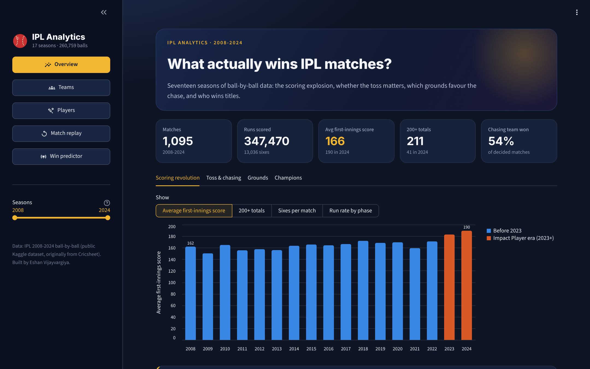
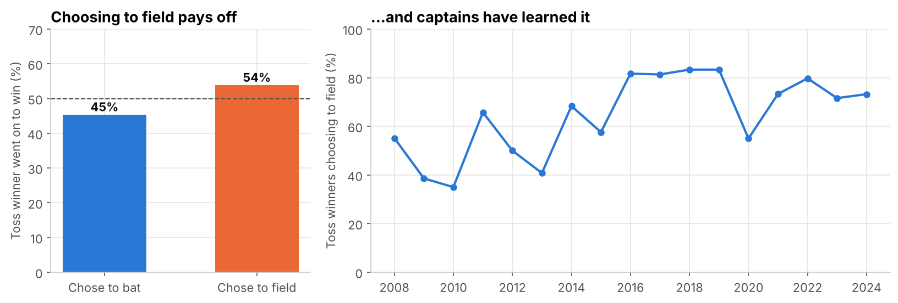
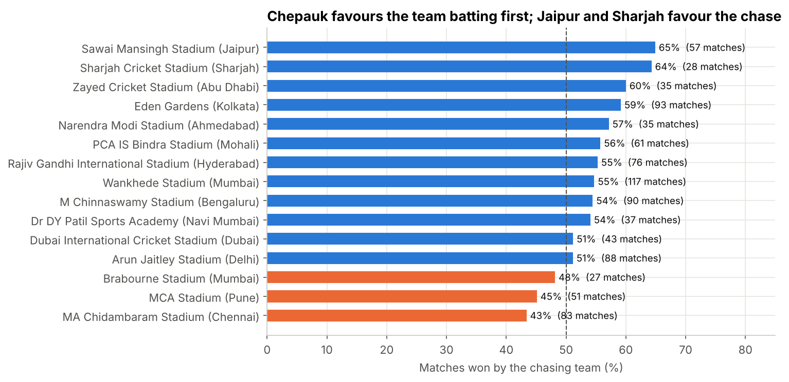
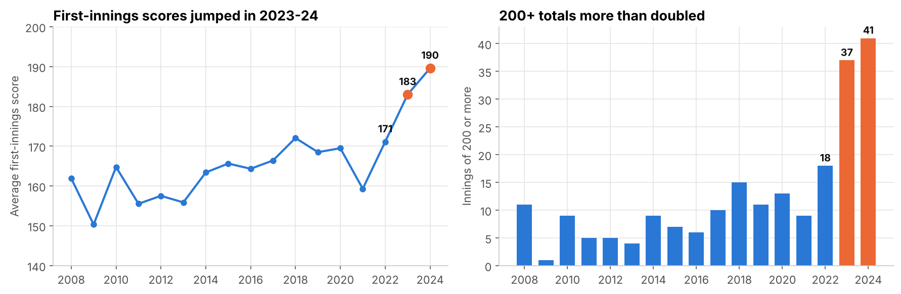
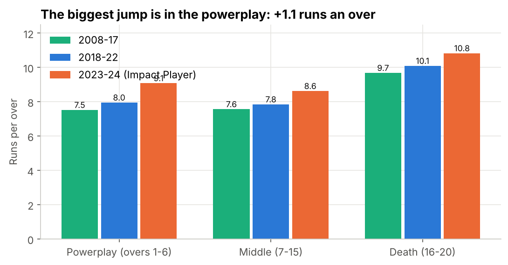
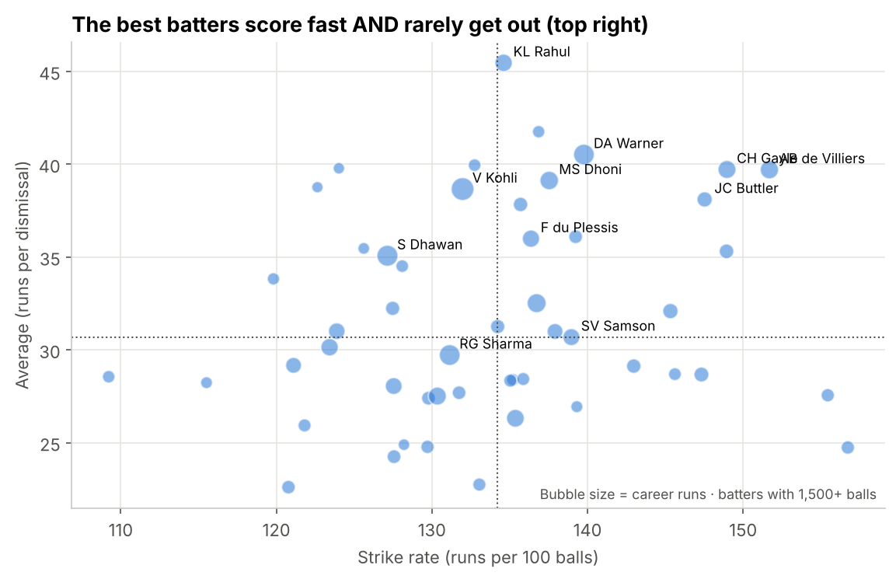
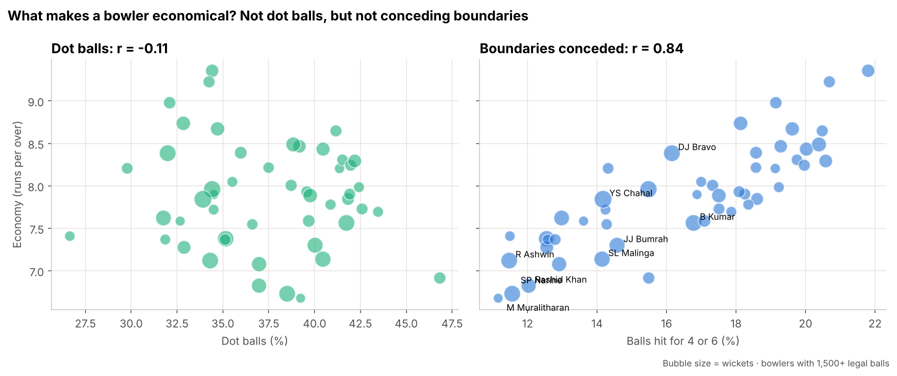
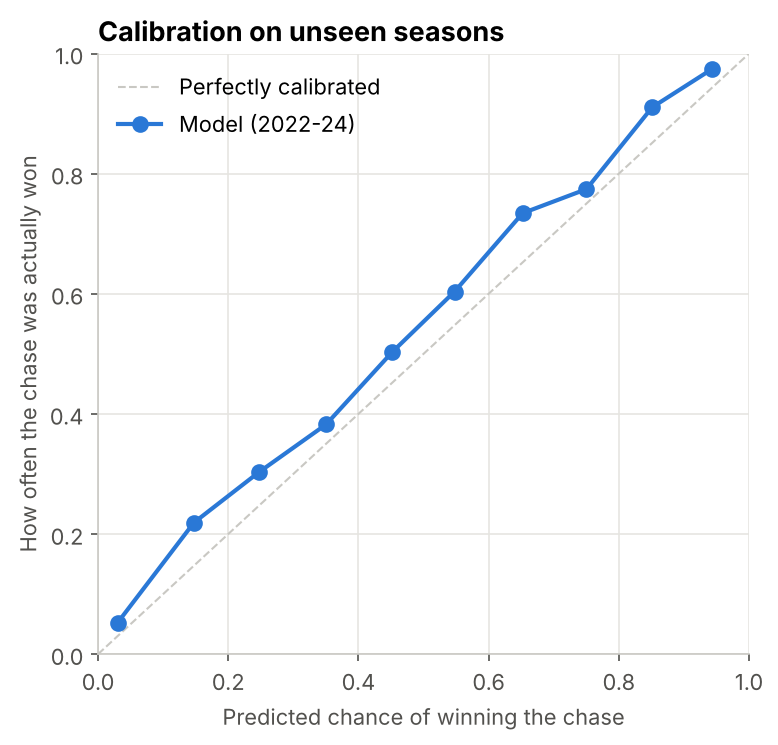
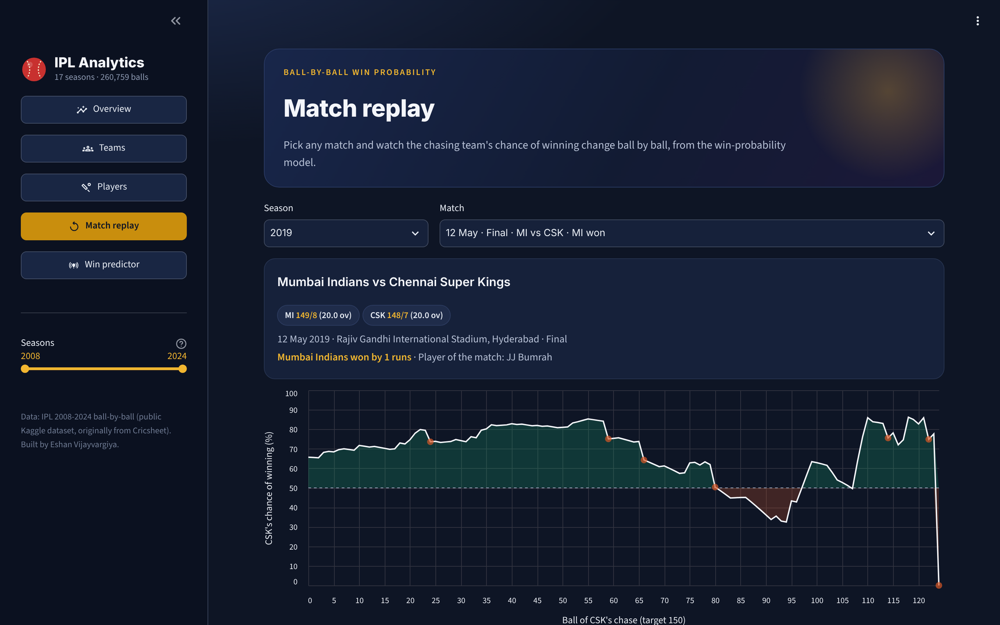
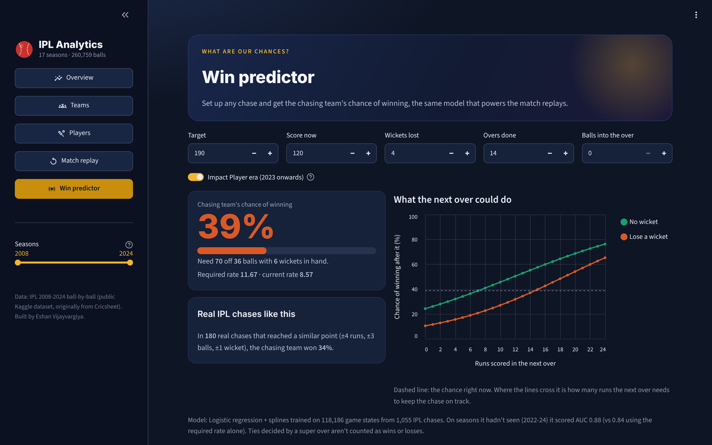

# IPL Analytics 2008-2024

**What actually wins IPL matches: the toss, the ground, or the 2023 Impact Player rule?**

An end-to-end analysis of **every IPL ball from 2008 to 2024**: 1,095 matches and 260,759 deliveries. I cleaned a messy real dataset (19 team names for 15 franchises, 58 spellings for 36 grounds), tested cricket's common beliefs with statistics, and built a **ball-by-ball win-probability model** that I tested on seasons it had never seen. Everything runs in a **five-page interactive app**.

**Headline:** winning the toss is a coin flip (50.8%, p = 0.61), but the ground isn't: chasing teams win **43% at Chepauk and 65% in Jaipur**. Since the Impact Player rule arrived in 2023, 200+ totals have more than doubled (**18 in 2022 → 41 in 2024**). The win-probability model scores **AUC 0.88 on 2022-24**, seasons it never trained on.

### ▶ [Try the live app](https://eshan-ipl-analytics.streamlit.app/)

[](https://eshan-ipl-analytics.streamlit.app/)
No install needed. Replay the 2019 final ball by ball, look up any player or team, or set up a chase in the **Win predictor** ("need 70 off 36 with 6 wickets left: what are our chances?"). (It's on free hosting, so if it has been asleep, click "Yes, get this app back up" and give it about a minute.)

     



---

## Findings at a glance

| # | Finding | Number |
|---|---|---|
| 1 | Winning the toss barely helps | Toss winners won **50.8%** (binomial test p = 0.61) |
| 2 | What you do with the toss matters more | Chose to field: **53.9%** won · chose to bat: **45.4%** (chi-square p = 0.009) |
| 3 | The ground matters more than the toss | Chases succeed **43%** at Chepauk, **65%** in Jaipur, **64%** in Sharjah |
| 4 | The Impact Player rule made scoring explode | Average first innings **171 (2022) → 190 (2024)** · 200+ totals **18 → 41** |
| 5 | The powerplay changed most | **7.9 → 9.1** runs an over (2018-22 vs 2023-24) |
| 6 | Two teams dominate | CSK and MI have won **10 of 17** titles |
| 7 | Economy is about boundaries, not dot balls | Correlation with economy: boundary % **r = 0.84**, dot-ball % **r = -0.11** |
| 8 | The best death bowlers | Narine **7.40**, Malinga **7.86**, Bumrah **8.29** runs an over in overs 16-20 (league: 10.0) |
| 9 | The same chase got easier after 2023 | Chasing 180: **42% → 51%** chance of winning |

## 1. Cleaning a messy real dataset

The raw files look tidy, but they aren't. `app/ipl_data.py` fixes all of this:

| Problem | Example | Fix |
|---|---|---|
| Text padded with spaces, missing values written as `NA` | `"  Kolkata Knight Riders  "` | Strip every text field, turn `NA` into a real blank |
| **19 team names for 15 franchises** | Delhi Daredevils → Delhi Capitals, Kings XI Punjab → Punjab Kings | Map old names to the current franchise |
| **58 venue spellings for 36 grounds** | "M.Chinnaswamy Stadium", "M Chinnaswamy Stadium, Bengaluru" | One name per ground, incl. renamed grounds (Feroz Shah Kotla → Arun Jaitley Stadium) |
| Super overs stored as innings 3-6 | 14 tied matches | Kept out of batting and bowling stats |
| Rain-shortened and abandoned matches | 21 D/L matches, 5 no-results | Excluded where they would bias the answer |

## 2. The toss, chasing and the grounds



Commentators call the toss "crucial", but toss winners win 50.8% of the time, which is statistically the same as a coin flip. **What captains do with it matters more:** fielding first wins 53.9%, and since 2016 about 3 in 4 captains choose it.



**The ground decides more than the toss.** At Chepauk (Chennai), spin and a slowing pitch make chasing hard (43%). In Jaipur and Sharjah, bowl first.

## 3. The scoring revolution



In 2023 the IPL allowed each team to bring in a substitute mid-match (the **Impact Player**), usually an extra batter. With more batting in hand, top orders attack from ball one: the average first-innings score jumped from 171 to 190 in two seasons, and sixes per match went from 14.4 to 17.8.



## 4. Players





**A surprise:** dot balls barely predict how economical a bowler is (r = -0.11), but boundaries conceded predict it very strongly (r = 0.84). Spinners like Narine, Ashwin and Rashid Khan bowl fewer dots than fast bowlers but give away a boundary only once every 8 to 9 balls. **For a captain, "don't get hit for four" matters more than "bowl dots".**

## 5. Ball-by-ball win-probability model

**Goal:** before every ball of a chase, estimate the chasing team's chance of winning.

**Data:** every legal ball of every normal chase (118,186 game states from 1,055 chases), described by runs needed, balls left, wickets left, the target and the era (before or after the Impact Player rule).

**A fair test:**
- **Train on 2008-2021, test on 2022-2024.** The test seasons come after the training seasons, just like real use, and they include the new Impact Player era.
- Cross-validation is **grouped by match**, so balls from the same match never sit on both sides of a split.

| Model | CV log loss (2008-21) | Test log loss (2022-24) | Test Brier | Test AUC |
|---|---|---|---|---|
| Baseline: required run rate only | 0.489 | 0.502 | 0.164 | 0.839 |
| Logistic regression | 0.440 | 0.448 | 0.147 | 0.871 |
| Gradient boosting | 0.445 | 0.451 | 0.147 | 0.874 |
| **Logistic regression + splines (final)** | 0.445 | **0.444** | **0.144** | **0.878** |

Lower log loss and Brier score are better. **Logistic regression with spline features** wins: it stays simple and explainable, but splines let it learn curves ("a required rate of 14 is far worse than 12, not just a bit worse").

**Are the percentages honest?** When the model says 70%, the chasing team should win about 70% of the time:



| Situation | Model says | Actually won | Real cases |
|---|---|---|---|
| Need 10 off 6, 2 wickets left | 54% | 55% | 11 |
| Need 10 off 6, 5 wickets left | 81% | 76% | 41 |
| Need 30 off 18, 5 wickets left | 64% | 61% | 51 |
| Need 60 off 36, 6 wickets left | 51% | 50% | 118 |

**Data drift:** on 2023-24 the model was a little too pessimistic about big chases, because it learned before 200+ chases became common. So the final model is retrained on all 17 seasons with the era as an input.


The 2019 final, ball by ball: CSK started at 66%, peaked at 86%, and were still at 78% before the last ball. Then Malinga trapped Shardul Thakur lbw, and MI won by one run.

## 6. The app

Five pages, all in one dark "floodlit stadium" theme:

| Page | What you can do |
|---|---|
| **Overview** | The scoring revolution, toss and chasing by season, every ground, all 17 champions |
| **Teams** | Any franchise's record season by season, top players, and head-to-head against any opponent |
| **Players** | Profile for any of 470 players: runs or wickets by season, strike rate or economy by phase against the league average, and any batter vs bowler matchup |
| **Match replay** | Pick any of 1,095 matches and see the win-probability chart ball by ball, with the biggest swings and runs per over |
| **Win predictor** | Set up any chase: the chance of winning, how real IPL chases from the same point ended, and what the next over could do |

The season slider in the sidebar filters the Overview, Teams and Players pages.

| Match replay | Win predictor |
|---|---|
|  |  |

## Project structure

```
ipl-analytics/
├── app/
│   ├── app.py              # the Streamlit app (5 pages)
│   ├── ipl_data.py         # cleaning: team and ground names, super overs, D/L, phases
│   ├── stats.py            # cricket stats: batting, bowling, venues, matchups (pure pandas)
│   ├── winprob.py          # win-probability features, model and ball-by-ball replay
│   ├── style.py            # page design
│   └── data/               # cleaned tables (matches.csv, balls.parquet, 1.5 MB)
├── models/                 # trained model + its test scores
├── notebooks/
│   └── ipl_analysis.ipynb  # the full analysis, top to bottom
├── images/                 # charts used in this README
├── scripts/get_data.py     # downloads the raw data
└── data/README.md          # where the data comes from
```

## Run it yourself

```bash
pip install -r requirements.txt
python -m streamlit run app/app.py
```

To re-run the notebook from the raw files:

```bash
pip install -r requirements-notebook.txt
python scripts/get_data.py
jupyter notebook notebooks/ipl_analysis.ipynb
```

## Limitations

- **Ball-by-ball data has no context**: no pitch reports, weather or dew, which matter for toss decisions at night.
- **The model only knows the score**, not who is batting. "Need 30 off 12" with Dhoni at the crease is not the same as with a tail-ender.
- **Two Impact Player seasons** is a small sample, so the "after 2023" numbers will move as more seasons arrive.
- D/L and super-over matches are left out of the model because their targets work differently.

**Data:** [IPL Complete Dataset (2008-2024)](https://www.kaggle.com/datasets/patrickb1912/ipl-complete-dataset-20082020), Kaggle. See [data/README.md](data/README.md).

---

Built by **Eshan Vijayvargiya**, MBA (Data Science), Narayana Business School · [GitHub](https://github.com/Eshan-vijayvargiya)
